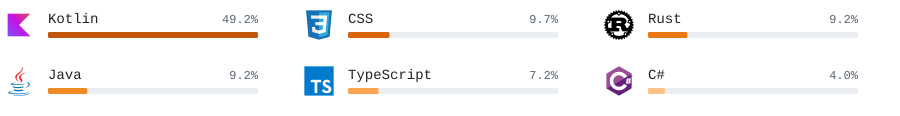

<picture><source media="(prefers-color-scheme: dark)" srcset="assets/header-dark.svg" /></picture>

<picture><source media="(prefers-color-scheme: dark)" srcset="https://raw.githubusercontent.com/th7bo/th7bo/output/languages-dark.svg" /></picture>

<picture><source media="(prefers-color-scheme: dark)" srcset="https://github-readme-stats.vercel.app/api?username=th7bo&hide_border=true&hide_title=true&hide_rank=true&show_icons=true&bg_color=00000000&text_color=9198a1&icon_color=ffb35c&card_width=420" /></picture>&nbsp;<picture><source media="(prefers-color-scheme: dark)" srcset="https://streak-stats.demolab.com/?user=th7bo&hide_border=true&background=00000000&ring=ffb35c&fire=ffb35c&currStreakNum=f0f6fc&currStreakLabel=ffb35c&sideNums=f0f6fc&sideLabels=9198a1&dates=9198a1&stroke=3d444d" /></picture>

<picture><source media="(prefers-color-scheme: dark)" srcset="https://github-readme-activity-graph.vercel.app/graph?username=th7bo&bg_color=00000000&color=9198a1&line=ffb35c&point=f0f6fc&area=true&area_color=ffb35c&hide_border=true&custom_title=%20&height=260" /></picture>

<picture><source media="(prefers-color-scheme: dark)" srcset="https://raw.githubusercontent.com/th7bo/th7bo/output/snake-dark.svg" /></picture>
